<div align="center">



<br/>

<a href="https://angular.dev"></a>
<a href="https://www.typescriptlang.org"></a>
<a href="https://rxjs.dev"></a>
<a href="https://tabler.io/icons"></a>


<p>
  <a href="#-quick-start"><b>Quick start</b></a> ·
  <a href="#-features"><b>Features</b></a> ·
  <a href="#-who-sees-what"><b>Roles</b></a> ·
  <a href="#-how-a-request-travels"><b>Architecture</b></a> ·
  <a href="#-project-structure"><b>Structure</b></a>
</p>

</div>


## ✨ Overview

**HRMS Client** is the Angular 17 frontend for an HR management system. It gives **Admins**, **HR staff**, and **Employees** a single, role‑aware dashboard for people, departments, compensation, and payroll — with lazy‑loaded feature areas, guarded routes, and a shared layout shell that keeps everything consistent.


## 🚀 Features

<table>
  <tr>
    <td width="33%" valign="top">
      <h3>👥 People</h3>
      Employee directory with create / edit forms and department management.
    </td>
    <td width="33%" valign="top">
      <h3>💰 Compensation</h3>
      Salary records, full <b>revision history</b>, bonuses, and deductions.
    </td>
    <td width="33%" valign="top">
      <h3>🧾 Payroll</h3>
      Payroll runs built from salary, bonus, and deduction data.
    </td>
  </tr>
  <tr>
    <td width="33%" valign="top">
      <h3>🔐 Access control</h3>
      <code>authGuard</code> + <code>roleGuard</code> on every protected route, and a sidebar that only shows what you can open.
    </td>
    <td width="33%" valign="top">
      <h3>🔄 Silent refresh</h3>
      JWTs attach automatically; a <code>401</code> triggers one refresh‑token retry before logging out.
    </td>
    <td width="33%" valign="top">
      <h3>🧩 Shared shell</h3>
      Header, sidebar, layout, and toast notifications reused across every feature.
    </td>
  </tr>
</table>


## 🔑 Who sees what

| Area | Route | 👑 Admin | 🧑‍💼 HR | 👤 Employee |
| :-- | :-- | :-: | :-: | :-: |
| Dashboard | `/dashboard` | ✅ | ✅ | ✅ *(own data)* |
| Employees | `/employees` | ✅ | ✅ | — |
| Departments | `/departments` | ✅ | ✅ | — |
| Salary & revisions | `/salary`, `/salary/revisions` | ✅ | ✅ | — |
| Deductions | `/deductions` | ✅ | ✅ | — |
| Bonuses | `/bonuses` | ✅ | ✅ | — |
| Payroll | `/payroll` | ✅ | ✅ | — |
| Auth & Users | `/users` | ✅ | — | — |

> [!TIP]
> Role rules live in two places: `data.roles` in [`app.routes.ts`](src/app/app.routes.ts) and the nav items in [`sidebar.component.ts`](src/app/shared/components/sidebar/sidebar.component.ts). Change both together.


## 🔁 How a request travels



- **`authInterceptor`** attaches `Authorization: Bearer <token>` (skipping `/auth/login` and `/auth/refresh`). On a `401` it tries the refresh token once, retries the original request, and clears the session if that fails.
- **`apiCaseInterceptor`** converts every response body's keys to camelCase, so templates bind to `employee.firstName` even when the API returns `FirstName`.
- **Session state** (`accessToken`, `refreshToken`, `role`, `userId`, `username`) is kept in `localStorage` and read by guards, interceptors, and the layout.


## ⚡ Quick start

<p>
  <a href="https://skillicons.dev"></a>
</p>

**Prerequisites:** Node.js 18+, npm, and the HRMS API running at `https://localhost:44368`.

```bash
# 1 · clone
git clone https://github.com/ahasan-ullah/HRMS-Client.git
cd HRMS-Client

# 2 · install
npm install

# 3 · run (proxies /api → https://localhost:44368)
npm start
```

Then open **http://localhost:4200** and sign in. 🎉

> [!NOTE]
> The backend URL lives in [`proxy.conf.json`](proxy.conf.json). Point `target` somewhere else if your API runs on a different host or port.

### 📜 Scripts

| Command | What it does |
| :-- | :-- |
| `npm start` | Dev server on `:4200` with the API proxy enabled |
| `npm run build` | Production build into `dist/` |
| `npm run watch` | Rebuild on change (development configuration) |
| `npm test` | Unit tests with Jasmine + Karma |


## 📁 Project structure

```text
src/
├── app/
│   ├── core/                 # app-wide plumbing
│   │   ├── guards/           # authGuard, roleGuard
│   │   ├── interceptors/     # authInterceptor, apiCaseInterceptor
│   │   ├── models/           # typed DTOs per domain
│   │   └── services/         # one HTTP service per API area
│   ├── features/             # lazy-loaded routes
│   │   ├── auth/             #   login
│   │   ├── dashboard/        #   role-aware overview
│   │   ├── employees/        #   list + form
│   │   ├── departments/
│   │   ├── salary/           #   list + revision history
│   │   ├── bonuses/
│   │   ├── deductions/
│   │   ├── payroll/
│   │   └── users/            #   Admin only
│   └── shared/
│       ├── components/       # header, sidebar, layout, toast-container
│       ├── services/         # toast.service
│       └── styles/           # _ui.scss design tokens
└── environments/             # apiUrl per build configuration
```

<details>
<summary><b>🔌 Backend endpoints this client expects</b></summary>
<br/>

The client calls the API under `/api` for these areas:

`auth` · `users` · `employees` · `departments` · `salary` · `payroll` · `bonuses` · `deductions` · `dashboard`

If the API contract changes, update the matching service and model in [`src/app/core/`](src/app/core).

</details>

<details>
<summary><b>🎨 Design tokens</b></summary>
<br/>

Shared colors and typography are defined once in [`_ui.scss`](src/app/shared/styles/_ui.scss):

| Token | Value | |
| :-- | :-- | :-: |
| `--navy` | `#071a3d` |  |
| `--blue` | `#416fb5` |  |
| `--accent` | `#0f766e` |  |
| `--success` | `#0f9f6e` |  |
| `--warning` | `#b7791f` |  |
| `--danger` | `#dc2626` |  |

</details>

<details>
<summary><b>🌍 Environments</b></summary>
<br/>

| File | Used by |
| :-- | :-- |
| [`environment.ts`](src/environments/environment.ts) | `ng serve`, development builds |
| [`environment.production.ts`](src/environments/environment.production.ts) | `ng build` (production) |

> [!IMPORTANT]
> `environment.production.ts` still has a placeholder `apiUrl` (`https://your-production-api.com/api`). Set the real API URL before you deploy.

</details>

<br/>

<div align="center">

**Built with Angular & ☕**

<a href="#top">⬆ Back to top</a>


</div>
